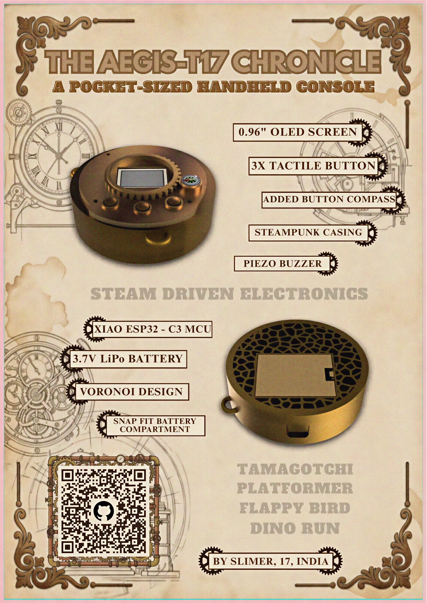
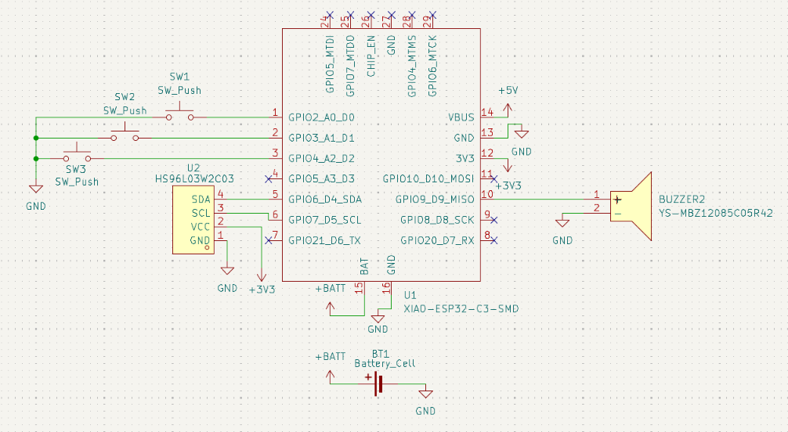

# THE AEGIS-T17 CHRONICLE

**A Pocket-Sized, Steampunk-Inspired Handheld Console**

This is the repository for **The Aegis-T17 Chronicle**, a custom-engineered, fully playable handheld console powered by the XIAO ESP32-C3 as the main brain. Housed in a custom 3D-printed steampunk casing with a voronoi design backplate, this device is a fusion of steampunk aesthetics and modern embedded C++ programming.



---

## The Games
The console features a main menu system that boots into four distinct games:

*   **Tamagotchi:** A virtual pet simulator with persistent state tracking (Hunger, Happiness, Energy), non-blocking timers, and dynamic PROGMEM face sprites.
*   **Flappy Bird:** A copy of the famous Flappy Bird game with randomized pipe generation, custom bird sprite and memory management using flash-stored bitmap rendering.
*   **Dino Run:** A copy of the classic infinite chrome dino run with velocity-based jump mechanics and inifnite obstacles.
*   **Platformer:** A custom 2D platformer featuring a Axis-Aligned Bounding Box (AABB) physics engine, separated axis collision resolution, friction, and dynamic level loading.

---

## Hardware Specifications ("Steam Driven Electronics")
The Aegis-T17 was designed with a minimal footprint, utilizing the following hardware components:

*   **Microcontroller:** Seeed Studio XIAO ESP32-C3
*   **Display:** 0.96" SSD1306 OLED Screen (128x64 resolution)
*   **Inputs:** 3x Tactile Push Buttons
*   **Audio:** Piezo Buzzer for sound effects
*   **Power:** 3.7V LiPo Battery
*   **Casing:** Custom 3D-printed Steampunk Casing featuring a Snap-Fit Battery Compartment, Voronoi patterned backplate, and a slot for a Button Compass.
*   **PCB** Custom designed PCB which houses all the parts on it and fits perfectly in the casing

---

## Software Architecture
The software avoids a single gigantic file in favor of a clean, state-driven C++ architecture:

*   `main.ino`: Handles the main menu UI, global state switching, and hardware initialization.
*   **Modular Game Files:** Each game is isolated into its own `.cpp` and `.h` files (e.g., `Platformer.cpp`, `Tamagotchi.cpp`).
*   **Custom Physics Engine:** The platformer utilizes a custom-written engine for collision checks, friction, etc.
*   **Zero-Copy Rendering:** Sprites are stored in `PROGMEM` as hexadecimal arrays and drawn directly to the OLED using memory pointers to save RAM.
*   **Consistent Frame Pacing:** Games utilize non-blocking `millis()` delta-time checks to maintain a strict ~30FPS (33ms) physics update loop.

---

## Getting Started

### Prerequisites
*   Arduino IDE
*   Board Manager: **esp32 by Espressif Systems** (Select Seeed Studio XIAO ESP32C3)
*   Library: **Adafruit SSD1306** and **Adafruit GFX Library**

### Wiring Guide

*   **OLED Display:** SDA -> ESP32 Pin 5 | SCL -> ESP32 Pin 6 | VCC -> 3.3V | GND -> GND
*   **Buttons (with INPUT_PULLUP):**
    *   Left Button -> Pin 1
    *   Middle/Jump Button -> Pin 2
    *   Right Button -> Pin 3
*   **Piezo Buzzer:** Positive -> Pin 10 | Ground -> GND


### Installation
1. Clone this repository.
2. Open the main `.ino` file in the Arduino IDE.
3. Ensure all `.cpp` and `.h` files are in the same directory.
4. Compile and flash to the XIAO ESP32-C3.

---

## 📜 Credits
*Designed, Engineered, and Programmed by* **SLIMER**.

*“Where steam-driven aesthetics meet modern microcontrollers.”*
```eof
